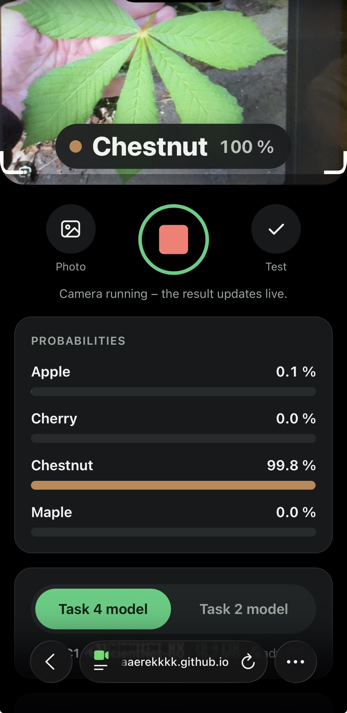

# Review of the phone page (Task 2)

Page: https://maaaerekkkk.github.io/mlr-ex08/

The page classifies the live image of the phone's rear camera directly in the browser using ONNX Runtime Web. It contains two models: the Task 2 model (`leaf_model.onnx`, MobileNetV3-Small) and the better Task 4 model (`leaf_model_final.onnx`, EfficientNet-B0), which is the default. You can switch between them. Both models use the same `model_info.json`, because they have the same classes, input size and normalization.

## 1. It works on my phone

I opened the page via the QR code on my phone in the Safari browser, allowed access to the camera and pointed it at a leaf the model had never seen before.

The page loaded without any installation and classified the live camera image. The Task 4 model recognized the leaf as chestnut with a probability of 100 %, while the Task 2 model cannot tell apart leaves of similar groups such as apple/cherry and maple/chestnut. The Task 4 model works best when the camera is brought fully close to the leaf, since the model was also trained on 96 × 96 px images.

Compared with the original version of the page, the Task 4 model with a switch and a new design were added: a large camera preview with a highlighted square that the model sees, a prominently displayed most likely class and probability bars for all classes. With the live camera, the probabilities are smoothed with a moving average so that they do not flicker.

## 2. The same numbers as in the notebook

Using the photo upload, I uploaded `check_image.jpg` to the page, separately with each model, and compared the probabilities with the values from the notebook.

| class | Task 2: page | Task 2: `check_expected.json` | Task 4: page | Task 4: `check_expected_final.json` |
| --- | --- | --- | --- | --- |
| apple | 0.643 | 0.643 | 0.889 | 0.889 |
| cherry | 0.356 | 0.356 | 0.108 | 0.108 |
| chestnut | 0.001 | 0.001 | 0.002 | 0.002 |
| maple | 0.000 | 0.000 | 0.000 | 0.000 |

For both models, the probabilities from the page agree with the notebook to three decimal places. The largest difference was of the order of 10⁻⁶, which corresponds to the numerical precision of a float32 computation. The Task 2 model classifies the check image correctly as apple with a confidence of 64 %, the Task 4 model with a confidence of 89 %. On other test data, however, the Task 4 model clearly outperforms the Task 2 model.

For the Task 4 model, the file `check_expected_final.json` was added with its probabilities on the same check image, computed in PyTorch with the transform from the notebook.

## 3. The preprocessing matches the model

According to `model_info.json`, the model has a 96 × 96 px input, normalization with mean [0.485, 0.456, 0.406] and std [0.229, 0.224, 0.225], and the classes in the order apple, cherry, chestnut, maple. In the notebook, the image is processed by the `ToTensor()` transform, which divides the pixel values by 255 and moves the channels to the front, and then by `Normalize(mean, std)`. The teacher's photos were centre-cropped to a square and resized to 96 × 96 px in advance.

In `index.html` I found the function `preprocess`, which contains the whole preprocessing, and compared the individual steps with `model_info.json` and with the notebook:

| step | where in `index.html` | match |
| --- | --- | --- |
| input size S, mean and std are loaded from `model_info.json` | line [230] | yes |
| the central square with side min(width, height) is cut out of the frame | line [252] | yes, the same as when the teacher prepared the photos |
| the square is resized to S × S = 96 × 96 | line [254] | yes |
| the channels R, G, B are taken from the RGBA bytes and the alpha channel is discarded | line [255] | yes, RGB order as in PIL |
| each value is divided by 255 and normalized as (x − mean) / std for its channel | lines [256–259] | yes, the same as `ToTensor` + `Normalize` |
| the channels are stored one after another as R, G, B planes (NCHW) | lines [257–259] | yes, as after `ToTensor` |
| a float32 tensor of shape [1, 3, S, S] is created | line [261] | yes |
| softmax is computed from the outputs (logits) | line [319] | yes, as `softmax(dim=1)` in the notebook |

The preprocessing on the page matches both `model_info.json` and the transform in the notebook. The page decodes uploaded JPEG photos with the mozjpeg library (WebAssembly, `vendor/jsquash-jpeg/`), i.e. with the same type of decoder that PIL uses in the notebook, and therefore the pixels are identical. The camera image is not decoded; it goes directly from the video to the canvas.

The preprocessing was originally split across several places. Now it is in one commented function `preprocess`, while the calculation logic stayed the same.

## 4. Nothing leaves the phone

In `index.html` I searched for all external addresses and network calls (`fetch`, `XMLHttpRequest`, `sendBeacon`, `WebSocket`, `FormData`). While uploading a photo and while the camera was running, I watched the Network tab in the browser's developer tools.

**The addresses the page loads, and why:**

- **From the page itself on GitHub Pages:**
  - `index.html`
  - `model_info.json`: description of the model and the preprocessing
  - `leaf_model_final.onnx` at start-up and `leaf_model.onnx` only after switching to the Task 2 model
  - the files of the JPEG decoder in `vendor/jsquash-jpeg/` (`decode.js`, `utils.js`, `meta.js`, `mozjpeg_dec.js`, `mozjpeg_dec.wasm`)
  - during the check, `check_image.jpg` and `check_expected*.json`
- **External, only from the jsdelivr CDN:** `onnxruntime-web@1.20.1` (`ort.min.js`, `ort-wasm-simd-threaded.mjs`, `ort-wasm-simd-threaded.wasm`), i.e. the library that runs the neural network in the browser.
- **`blob:` addresses** are local references in the browser's memory to the uploaded photo, not network requests.

**What I found:** All requests are of type GET and have no body, so they send nothing. No new request appeared while the camera was running. The camera image is only drawn onto a canvas and processed by the model directly in the browser, so the photo does not leave the phone.

The mozjpeg decoder was originally downloaded from the jsdelivr CDN as a second external source. Now it is stored directly in the repository (`vendor/`, Apache-2.0 licence), so the onnxruntime-web library remains the only external source.

---

*This text was written and checked by me and then translated into English with the help of AI. My original Slovak version follows below.*

*Tento text som napísal a skontroloval ja a následne bol pomocou AI preložený do angličtiny. Nižšie nasleduje moja pôvodná slovenská verzia.*

---

# Kontrola stránky na mobil (Task 2)

Stránka: https://maaaerekkkk.github.io/mlr-ex08/

Stránka klasifikuje živý obraz zadnej kamery mobilu priamo v prehliadači pomocou ONNX Runtime Web. Obsahuje dva modely: model z Tasku 2 (`leaf_model.onnx`, MobileNetV3-Small) a lepší model z Tasku 4 (`leaf_model_final.onnx`, EfficientNet-B0), ktorý je predvolený. Medzi nimi sa dá prepínať. Oba modely používajú rovnaký `model_info.json`, pretože majú rovnaké triedy, veľkosť vstupu aj normalizáciu.

## 1. Funguje na mojom mobile

Stránku som otvoril cez QR kód na mobile v prehliadači Safari, povolil som prístup ku kamere a namieril som ju na list, ktorý model ešte nikdy predtým nevidel.

Stránka sa načítala bez inštalácie a klasifikovala živý obraz kamery. Model z Tasku 4 rozpoznal list ako chestnut s pravdepodobnosťou 100 %, zatiaľ čo model z Tasku 2 nevie rozoznať listy podobných skupín, ako sú apple/cherry a maple/chestnut. Model z Tasku 4 funguje najlepšie, ak sa záber kamery úplne priblíži na list, nakoľko aj model bol trénovaný na obrázkoch 96 × 96 px.

K pôvodnej verzii stránky pribudol model z Tasku 4 s prepínačom a nový dizajn: veľký náhľad kamery so zvýrazneným štvorcom, ktorý vidí model, výrazne zobrazená najpravdepodobnejšia trieda a pruhy pravdepodobností pre všetky triedy. Pravdepodobnosti sa pri živej kamere vyhladzujú kĺzavým priemerom, aby neblikali.

## 2. Rovnaké čísla ako v notebooku

Cez nahrávanie fotky som na stránku nahral `check_image.jpg`, zvlášť s každým modelom, a pravdepodobnosti som porovnal s hodnotami z notebooku.

| trieda | Task 2: stránka | Task 2: `check_expected.json` | Task 4: stránka | Task 4: `check_expected_final.json` |
| --- | --- | --- | --- | --- |
| apple | 0,643  | 0,643 | 0,889 | 0,889 |
| cherry |  0,356  | 0,356 | 0,108 | 0,108 |
| chestnut | 0,001 | 0,001 | 0,002 | 0,002 |
| maple | 0,000 | 0,000 | 0,000  | 0,000 |

Pri oboch modeloch sa pravdepodobnosti zo stránky zhodujú s notebookom na tri desatinné miesta. Najväčší rozdiel bol rádovo 10⁻⁶, čo zodpovedá numerickej presnosti výpočtu vo float32. Model z Tasku 2 klasifikuje kontrolný obrázok správne ako jabloň s istotou 64 %, model z Tasku 4 s istotou 89 %. Pri iných testovacích dátach však model z Tasku 4 prekonáva model z Tasku 2 výrazne.

Pre model z Tasku 4 pribudol súbor `check_expected_final.json` s jeho pravdepodobnosťami na rovnakom kontrolnom obrázku, vypočítanými v PyTorchi s transformáciou z notebooku.

## 3. Predspracovanie zodpovedá modelu

Podľa `model_info.json` má model vstup 96 × 96 px, normalizáciu s mean [0,485; 0,456; 0,406] a std [0,229; 0,224; 0,225] a triedy v poradí apple, cherry, chestnut, maple. V notebooku sa obrázok spracuje transformáciou `ToTensor()`, ktorá vydelí hodnoty pixelov 255 a presunie kanály dopredu, a potom `Normalize(mean, std)`. Učiteľove fotky boli vopred vyrezané na stredový štvorec a zmenšené na 96 × 96 px.

V `index.html` som našiel funkciu `preprocess`, v ktorej je celé predspracovanie, a porovnal som jednotlivé kroky s `model_info.json` a s notebookom:

| krok | kde v `index.html` | zhoda |
| --- | --- | --- |
| veľkosť vstupu S, mean a std sa načítajú z `model_info.json` | riadok [230] | áno |
| zo záberu sa vyreže stredový štvorec so stranou min(šírka, výška) | riadok [252] | áno, rovnako ako pri príprave fotiek učiteľom |
| štvorec sa zmenší na S × S = 96 × 96 | riadok [254] | áno |
| z RGBA bajtov sa berú kanály R, G, B a alfa kanál sa zahodí | riadok [255] | áno, poradie RGB ako v PIL |
| každá hodnota sa vydelí 255 a normalizuje ako (x − mean) / std pre svoj kanál | riadky [256–259] | áno, rovnako ako `ToTensor` + `Normalize` |
| kanály sa ukladajú za sebou ako roviny R, G, B (NCHW) | riadky [257–259] | áno, ako po `ToTensor` |
| vznikne tenzor float32 tvaru [1, 3, S, S] | riadok [261] | áno |
| z výstupov (logits) sa počíta softmax | riadok [319] | áno, ako `softmax(dim=1)` v notebooku |

Predspracovanie na stránke zodpovedá `model_info.json` aj transformácii v notebooku. Nahrané JPEG fotky stránka dekóduje knižnicou mozjpeg (WebAssembly, `vendor/jsquash-jpeg/`), teda rovnakým typom dekodéra, aký používa PIL v notebooku, a preto sú pixely zhodné. Obraz z kamery sa nedekóduje, ide priamo z videa na canvas.

Predspracovanie bolo pôvodne rozdelené na viac miest. Teraz je v jednej komentovanej funkcii `preprocess`, pričom logika výpočtu ostala rovnaká.

## 4. Nič neopúšťa mobil

V `index.html` som vyhľadal všetky externé adresy a sieťové volania (`fetch`, `XMLHttpRequest`, `sendBeacon`, `WebSocket`, `FormData`). Počas nahrania fotky a behu kamery som sledoval záložku Network vo vývojárskych nástrojoch prehliadača.

**Adresy, ktoré stránka načítava, a prečo:**

- **Z vlastnej stránky na GitHub Pages:**
  - `index.html`
  - `model_info.json`: popis modelu a predspracovania
  - `leaf_model_final.onnx` pri štarte a `leaf_model.onnx` až po prepnutí na model z Tasku 2
  - súbory dekodéra JPEG vo `vendor/jsquash-jpeg/` (`decode.js`, `utils.js`, `meta.js`, `mozjpeg_dec.js`, `mozjpeg_dec.wasm`)
  - pri kontrole `check_image.jpg` a `check_expected*.json`
- **Externe, iba z CDN jsdelivr:** `onnxruntime-web@1.20.1` (`ort.min.js`, `ort-wasm-simd-threaded.mjs`, `ort-wasm-simd-threaded.wasm`), čiže knižnica, ktorá spúšťa neurónovú sieť v prehliadači.
- **Adresy `blob:`** sú lokálne odkazy v pamäti prehliadača na nahranú fotku, nie sieťové požiadavky.

**Čo som zistil:** Všetky požiadavky sú typu GET a nemajú žiadne telo, takže nič neposielajú. Počas behu kamery nepribudla žiadna nová požiadavka. Obraz z kamery sa kreslí iba na canvas a spracúva ho model priamo v prehliadači, takže fotka mobil neopúšťa.

Dekodér mozjpeg sa pôvodne sťahoval z CDN jsdelivr ako druhý externý zdroj. Teraz je uložený priamo v repozitári (`vendor/`, licencia Apache-2.0), takže jediným externým zdrojom ostala knižnica onnxruntime-web.
